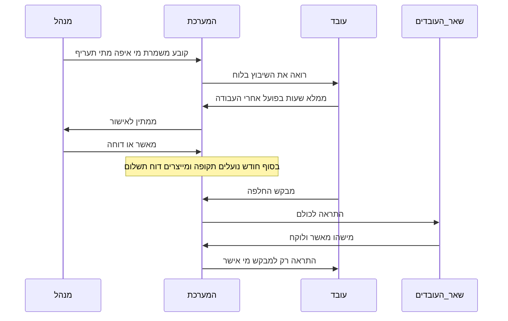

# אפיון מערכת ניהול עובדים ושכר

מערכת קהילתית להעסקת בני נוער ביישוב. עובד מדווח מתי עבד, מה העבודה, איפה, וכמה שעות. מנהל משבץ, קובע תעריפים, מאשר דיווחים, ומפיק דוח תשלום חודשי.

## 1. איפה יושב המידע

PostgreSQL מנוהל ב-[Supabase](https://supabase.com), אזור `eu-central-1`.

לא Excel, לא Google Sheets, ולא קבצים במחשב של המנהל: יש כמה משתמשים במקביל, הרשאות שונות, היסטוריה, החלפות ודוחות שכר.

לא Firebase: דיווחים, תעריפים, החלפות ודוח חודשי הם נתונים יחסיים. SQL מתאים לזה.

### טבלאות ליבה

| טבלה | תפקיד |
| --- | --- |
| `users` | שם, טלפון, אימייל, תפקיד (`worker` / `manager`), פעיל/לא פעיל |
| `worker_profiles` | תאריך לידה, טלפון הורה, פרטי תשלום (בנק/ביט), תעריף אישי אם יש |
| `sites` | מקומות עבודה |
| `job_types` | סוגי עבודה |
| `pay_rates` | שכר לשעה לפי סוג עבודה / גיל / עובד |
| `shifts` | שיבוץ שהמנהל קבע: מי, איפה, מה, מתי, שעות מתוכננות |
| `time_entries` | דיווח בפועל. סטטוס: `draft` / `submitted` / `approved` / `rejected` |
| `swap_requests` | בקשת החלפה, סטטוס, מי לקח |
| `notifications` | תור התראות (למי, סוג, נקרא/לא) |
| `payroll_periods` | חודש סגור: תאריך נעילה, מי נעל |
| `audit_log` | מי שינה דיווח, שיבוץ או תעריף |

כלל: **העובד ממלא, המנהל מאשר**. בלי אישור אין שכר.

גיבוי: גיבוי יומי של Supabase, ובנוסף ייצוא Excel חודשי אצל המנהל.

פרטיות: בני נוער — לא לשמור מעבר לצורך, גישה למנהלים מורשים בלבד, בלי תעודת זהות אלא אם יש צורך אמיתי.

הרשאות שורה: עובד רואה רק את עצמו (משמרות, דיווחים, שכר מאושר, היסטוריה). מנהל רואה הכול.

## 2. איפה יושב הקוד

בריפו Git הזה. כשנגיע למימוש (לא עכשיו):

- `app/` — ממשק ווב (עובד + מנהל) ו-API
- `lib/` — שכר, החלפות, הרשאות
- `supabase/` — מיגרציות

סטאק: Next.js + TypeScript, Supabase Auth (טלפון או אימייל) + Realtime, PWA לטלפון בלי חנות אפליקציות.

אין שרת בבית: אם המחשב כבוי, אף אחד לא מדווח ולא מחליף משמרת.

## 3. באיזה שרת זה רץ

| חלק | איפה רץ |
| --- | --- |
| מסכים + API | Vercel |
| מידע + התחברות + Realtime | Supabase |
| קבצים (PDF בהמשך, אופציונלי) | Supabase Storage |

עלות צפויה ליישוב קטן: בדרך כלל 0–15 דולר לחודש. אפשר דומיין יישובי אם יש.

לא נבחר כברירת מחדל: Cloudflare Pages/Workers/D1, VPS, או שרת פיזי ביישוב.

## 4. תהליך עבודה

שני מסלולים חיים יחד: שיבוץ של המנהל, ודיווח בפועל של העובד.

**עובד:** לוח משמרות, דיווח שעות, בקשת החלפה, היסטוריה, סיכום חודשי (שעות וכסף מאושר).

**מנהל:** שיבוץ, תעריפים, אתרים, תור אישור דיווחים, החלפות, דוח שכר חודשי, ייצוא Excel/PDF.

נעילת חודש: אחרי אישור, החודש נסגר. שינוי דורש פתיחה מחדש עם רשומה ב-`audit_log`.

### החלפות

- בקשה רק למשמרת עתידית של המבקש.
- התראה לכל העובדים הפעילים כשהבקשה נפתחת.
- מי שמאשר לוקח את המשמרת; המבקש מתפנה ממנה.
- התראה חוזרת רק למבקש, עם שם המאשר.
- תפוגה: אם אף אחד לא לקח עד פרק זמן לפני תחילת המשמרת, הבקשה נסגרת.

## 5. שכר

חישוב גרסה 1 בלבד:

`סכום לתשלום = סכום (שעות מאושרות × תעריף השורה)`

- תעריף לפי סוג עבודה / גיל / עובד ספציפי.
- רק `time_entries` בסטטוס `approved` נכנסים לדוח.
- בסוף חודש: נעילת `payroll_periods` + ייצוא Excel (שם, שעות, תעריף, סה״כ).
- העובד רואה את אותם סכומים מאושרים אצלו, כולל היסטוריה וסטטיסטיקות חודשיות.

לא בגרסה 1: מס הכנסה, ביטוח לאומי, ניכויים, שכר נטו, תלוש רשמי.

## 6. התראות

גרסה 1:

- רשומה ב-`notifications` לכל נמען.
- Web Push לטלפון אם העובד אישר הרשאה בדפדפן.
- פעמון בממשק עם נקרא/לא נקרא.

גרסה 2 (לא עכשיו): וואטסאפ דרך ספק חיצוני.

אירועים:

| אירוע | נמענים |
| --- | --- |
| בקשת החלפה חדשה | כל העובדים הפעילים מלבד המבקש |
| אישור החלפה | המבקש בלבד (כולל מי אישר) |
| דחיית דיווח / תזכורת אישור | לפי הצורך, בלי וואטסאפ בגרסה 1 |

## 7. מסכים

עובד: התחברות, היום/השבוע שלי, דיווח שעות, בקשת החלפה ורשימת בקשות פתוחות, היסטוריה, סטטיסטיקות וסיכום חודשי, פעמון התראות.

מנהל: לוח שיבוץ, ניהול עובדים/אתרים/סוגי עבודה/תעריפים, תור אישור דיווחים, בקשות החלפה, דוח שכר חודשי + ייצוא, נעילת חודש.

## 8. שיפורים לפי עדיפות

חובה בגרסה 1:

- אישור שעות לפני תשלום
- מניעת משמרות חופפות לאותו עובד
- החלפה רק למשמרות עתידיות, עם תפוגה
- תעריף לפי גיל / סוג עבודה
- ייצוא Excel לגזבר / רואה חשבון
- עברית מלאה ו-RTL, ממשק גדול לטלפון
- כניסה בטלפון (OTP ב-SMS), לא רק אימייל
- התרעה למנהל אם משמרת חורגת משעות מותרות לפי גיל
- טלפון חירום של הורה בכרטיס העובד

שימושי, לא חובה בגרסה 1:

- משתמש הורה לקריאה בלבד
- לוח שנה חודשי צבעוני
- משמרות חוזרות
- סימון אי-הגעה / ביטול ברגע האחרון
- סטטיסטיקות למנהל (מי עובד הרבה, עלות לפי אתר)
- העדפות אתרים של עובד
- מצב אופליין קל לדיווח

לא בגרסה 1:

- אפליקציית iOS/Android בחנויות
- שעון נוכחות עם GPS/תמונה
- נוכחות ביומטרית
- חישוב מס מלא ותלוש רשמי

## 9. מה לא נעשה בתיעוד הזה

אין קוד אפליקציה, אין הקמת שרת, אין טבלאות אמיתיות ב-Supabase. המימוש יתחיל רק באישור נפרד, בסדר: מודל נתונים והתחברות → דיווח ואישור → שיבוץ והחלפות → דוחות וסטטיסטיקות.
